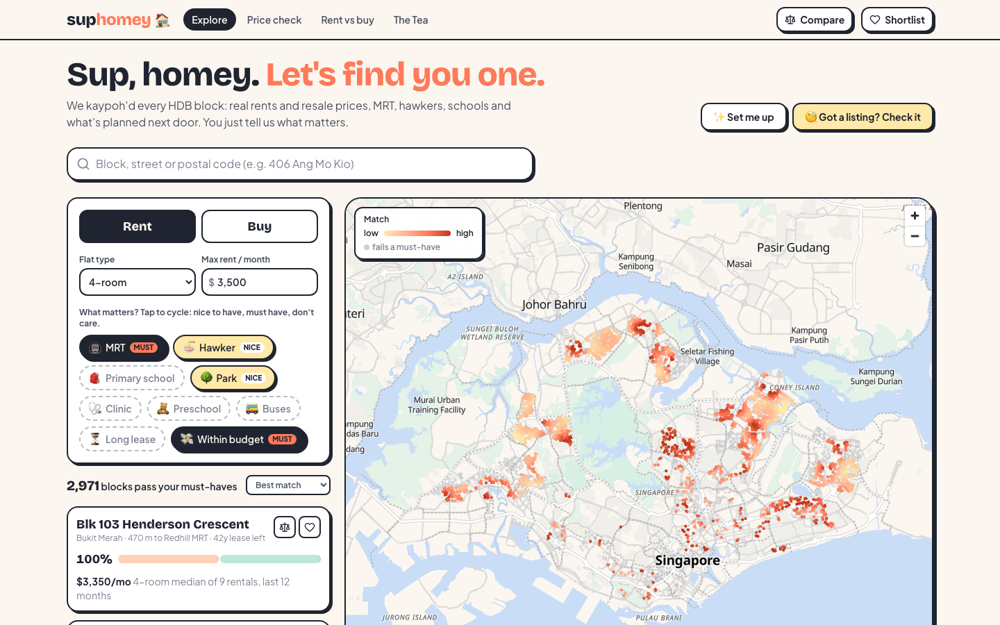
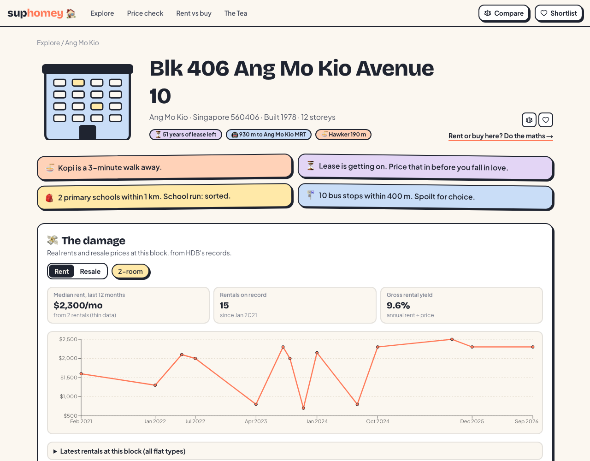
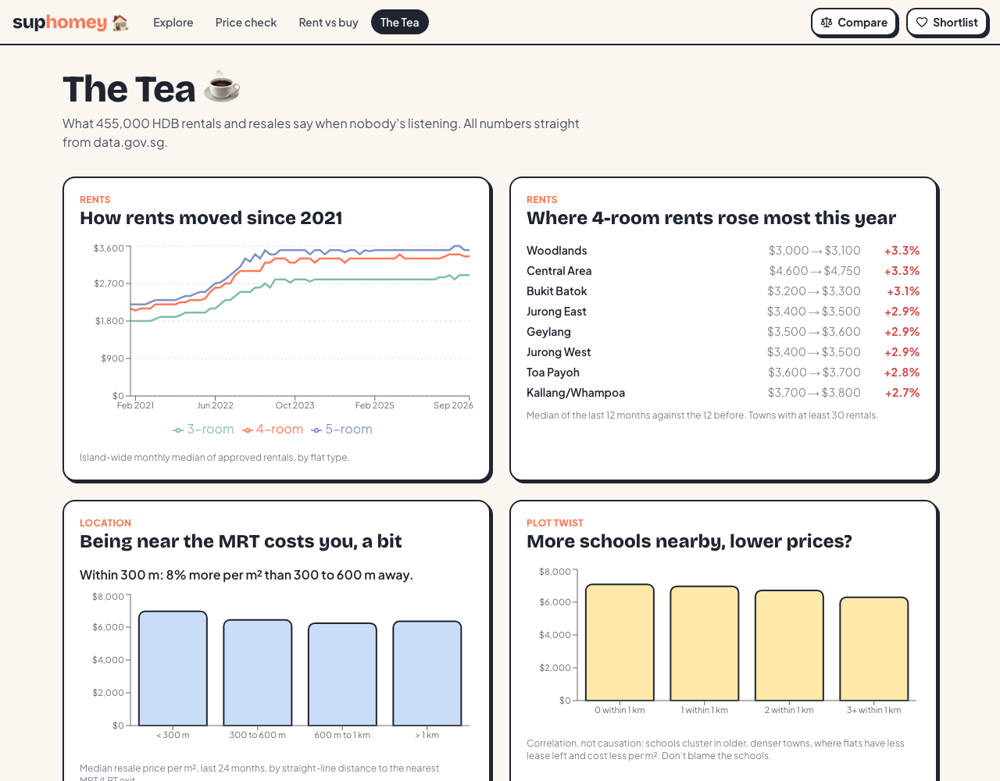

# suphomey 🏠

**Sup, homey. Let's find you one.** suphomey helps people choose an HDB flat to rent or buy. It
kaypohs (Singlish: nosily looks into) every HDB block in Singapore using about 30 datasets from
[data.gov.sg](https://data.gov.sg): real rents and resale prices, MRT exits, hawker centres and their
closure days, schools, preschool vacancies, clinics, parks, live carpark lots, and what the Master
Plan says will be built next door.

**Live demo: [suphomey.vercel.app](https://suphomey.vercel.app)**



## What you can do

- **Explore** every HDB block on a map. Tap preference chips (MRT, hawker, primary school, park,
  clinic, preschool, buses, long lease, budget) to cycle between *don't care*, *nice to have* (adds
  to the match %) and *must have* (filters). Each block shows its match % with a bar explaining why.
  Your search lives in the URL, so it can be shared.
- **Set me up**: a three-step quiz ("Hawker is my kitchen", "Kids in primary school"...) that sets the
  chips for you.
- **Kaypoh a block**: real rent and resale history, lease left, flat mix, nearest MRT exits, bus stops,
  HDB carparks with live lots, hawker centres with their next cleaning closure, primary schools within
  1 and 2 km, preschool vacancies by level and month, student care fees, clinics, parks, upgrading
  programmes, Master Plan zoning within 500 m, and active dengue clusters.
- **Fair Price Check**: paste an asking rent or price, see where it sits among real deals at the
  block, street or town, with a verdict ("Bit atas. Most people here paid less.").
- **Rent vs Buy**: break-even year using the block's real medians, with every assumption editable.
- **Compare** up to three blocks side by side, and keep a **shortlist** you can share by link.
- **The Tea**: insights from 455,000 transactions (below).

| Block page | The Tea |
|---|---|
|  |  |

## Quick start

### Option A: Docker only (no Node needed)

```bash
docker compose --profile app up --build
```

Open http://localhost:3000. Compose starts Postgres, applies migrations, loads the committed data
snapshot (`data/seed`, about 40 s), then starts the app. No API keys are needed, and the app does not
call data.gov.sg to start (building the images does download packages).

### Option B: local development

Requires Node 22 and pnpm 10 (`corepack enable`), plus Docker for Postgres.

```bash
pnpm install
cp .env.example .env          # points at the Postgres below; no keys needed
docker compose up -d db       # Postgres 18 on localhost:5434
pnpm db:migrate
pnpm db:seed                  # loads data/seed (about 40 s)
pnpm dev                      # http://localhost:3000
```

To refresh from the live data.gov.sg API (the same jobs the daily cron runs):

```bash
pnpm ingest                   # or one job: pnpm ingest rentals
```

## Tests

```bash
pnpm test         # 102 unit and integration tests across all packages; no database or server needed
pnpm typecheck
pnpm lint
pnpm e2e          # 14 Playwright tests (7 journeys x desktop and mobile); needs the app running
```

| Layer | What is tested | How |
|---|---|---|
| `packages/core` | Match scoring, percentiles and verdicts, rent vs buy, lease maths, geometry, address parsing | Vitest, numbers checked by hand (Python) |
| `packages/ingest` | Parsers on rows shaped like the real files, block location matching, refresh jobs (reload window, new blocks, run logging) | Vitest + PGlite, fake fetcher (no network) |
| `packages/db` | Queries: medians, search ranking, wildcard safety, price samples | Vitest + PGlite (Postgres in WebAssembly) |
| `apps/web` | API routes (validation, 404s, cron auth, caching headers), ranking, URL state, formatting, components | Vitest + PGlite, Testing Library |
| `infra` | Database private and encrypted, secrets never in plain env vars, ALB reachable only from CloudFront, schedule, alarms | CDK assertions |
| `e2e` | Explore with chips, search, Fair Price Check, shortlist and compare, rent vs buy, insights | Playwright, desktop and mobile |

CI (`.github/workflows/ci.yml`) runs all of it, with the e2e job against a production build and a
seeded Postgres service.

## Architecture

```
data.gov.sg ──> packages/ingest ──> data/seed (committed) ──> Postgres ──> packages/db ──> Next.js API ──> React UI
   (CSV, GeoJSON,   parse, validate,                          (Neon / RDS /   typed queries   thin route      map, chips,
    live APIs)      locate blocks,                             Docker)                         handlers        block pages
                    precompute distances                                     packages/core: scoring, prices, finance (shared by API and UI)
```

The key design decision is to **do the spatial work once, at ingestion**: distances from every block
to 7,520 places (plus bus stops, playgrounds and fitness corners for counts), and Master Plan zoning
around each block, are precomputed into plain tables.
Requests then only read indexed rows, and scoring 10,800 blocks happens in the browser in a few
milliseconds, so toggling a chip is instant. Full details, alternatives considered and the data model
are in [docs/ARCHITECTURE.md](docs/ARCHITECTURE.md).

| Layer | Stack |
|---|---|
| App | Next.js 16 (App Router), React 19, TypeScript, Tailwind CSS 4, Radix, TanStack Query, MapLibre GL (OpenFreeMap tiles), Recharts |
| Data | PostgreSQL, Drizzle ORM, Zod |
| Ingestion | Node 22, csv-parse, k-d tree / R-tree spatial indexes (kdbush, flatbush), proj4 |
| Tests | Vitest, PGlite, Testing Library, Playwright, CDK assertions |
| Infra | Vercel + Neon (demo), AWS CDK (production design): CloudFront, ALB, ECS Fargate, RDS, EventBridge Scheduler, Secrets Manager, CloudWatch |
| Tooling | pnpm workspaces, ESLint, Docker Compose, GitHub Actions |

```
apps/web          Next.js app: pages, components, API route handlers
packages/core     Pure domain logic (no I/O): scoring, prices, finance, geometry
packages/db       Drizzle schema, migrations, queries, insight queries
packages/ingest   Download, parse, locate blocks, build seed, load, daily refresh jobs
data/seed         Committed processed snapshot (~11 MB gzipped JSON)
infra             AWS CDK stack and its tests
e2e               Playwright tests
docs              Architecture, data notes, deployment
```

## Deployment

There are two deployment targets, on purpose:

- **AWS is the production design, as Infrastructure as Code** ([`infra/`](infra/README.md), AWS CDK
  in TypeScript). It defines everything needed to deploy and operate the app: network, database,
  containers, CDN, secrets, the daily data refresh, logs and alarms. Its 9 tests run in CI, and
  [`deploy-aws.yml`](.github/workflows/deploy-aws.yml) deploys it from GitHub Actions on demand. It
  has not been deployed to a real AWS account, since the always-on parts cost roughly USD 120 to 150
  a month.
- **Vercel + Neon hosts the [live demo](https://suphomey.vercel.app)** ([docs/DEPLOYMENT.md](docs/DEPLOYMENT.md)) at a cost of nothing.
  Daily refresh via Vercel Cron, functions pinned to Singapore next to the database.

Both run the same code against Postgres; only the hosting differs.

## Insights (snapshot of 15 Oct 2026)

From the data, as shown on The Tea page:

- **Rents are flat to creeping, not spiking.** Over the last 12 months, 4-room median rents changed
  between -2.9% (Serangoon) and +3.3% (Woodlands, Central Area) across 27 towns.
- **Living near the MRT costs about 8% more.** Resale flats within 300 m of an MRT/LRT exit sold for a
  median $6,963 per m², against $6,441 at 300 to 600 m.
- **BTO is far cheaper than resale.** In Punggol, the latest 4-room BTO range was $318k to $429k
  (FY2023), against a 12-month resale median of $680k.
- **Plot twist: more schools nearby, lower prices per m².** Blocks with 3+ primary schools within 1 km
  sold for $6,301 per m², against $7,080 with none. Schools cluster in older, denser towns, so this is
  a location effect, not a school effect; the page says so.
- **Bargains near rail exist.** The cheapest 4-room rents within 400 m of a station (median of at
  least 3 rentals) start around $2,000 a month.

## Data notes and limitations

Rent and resale records carry no coordinates, many blocks have very few rentals, and several files
have quirks (duplicate rows, station codes instead of names, lost characters). How each was handled,
and the limits of the methods (straight-line distances, lease year assumptions), are in
[docs/DATA.md](docs/DATA.md).

Not financial advice, just very nosy.
